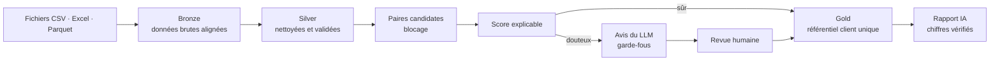

# ◆ Unifia : nettoyage et unification de données, assistés par l'IA

**Unifia** est un outil de qualité des données utilisable dans le navigateur. Il propose deux modes :

| Mode | Pour quoi faire | Exemple |
|---|---|---|
| **Nettoyer un fichier** | Un tableau quelconque avec des doublons, des cases vides, des valeurs aberrantes ou des formats mélangés | Un export de ventes : « 1 234,56 € », âges de 250 ans, « N/A »… |
| **Unifier des fichiers clients** | Les mêmes clients dispersés dans plusieurs logiciels, écrits différemment, en double | Un CRM, une boutique en ligne et un service client qui ne se parlent pas |

> **[▶ Tester la démo](https://fredericmoukengue.fr/unifia)** · données de démonstration incluses, aucun fichier nécessaire.
> Toutes les données de démonstration sont fictives.

---

## Le problème

Dans une entreprise, un même client existe souvent plusieurs fois : « Lucie Pons » dans le CRM, « PONS Lucie » à la boutique, « Mme Pons » sans prénom au service client. Les numéros de téléphone sont écrits de cinq façons, les e-mails avec des majuscules ou des espaces. Résultat : des envois en double, des chiffres de vente faux, et aucune vue complète du client.

Les outils généralistes (Excel, un LLM à qui l'on donne le fichier) atteignent vite leurs limites : volume, reproductibilité, impossibilité de vérifier leurs décisions.

## Ce que fait Unifia

### Mode 1 : l'atelier de nettoyage
1. **Diagnostic** colonne par colonne : contenu détecté (nombre, date, e-mail, « nombre écrit en texte »…), vides, valeurs aberrantes, espaces en trop.
2. **Propositions** dans un ordre réfléchi (les valeurs aberrantes sont traitées **avant** de remplir les vides), avec leur justification (« médiane conseillée : quelques valeurs extrêmes tirent la moyenne »).
3. **10 opérations** : doublons, vides (médiane, moyenne, valeur la plus fréquente, valeur choisie), valeurs aberrantes (signaler, plafonner, supprimer), conversion des nombres au format français et des dates, nettoyage du texte, remplacement de faux vides (« N/A »)…
4. **Journal** avec annulation, export CSV/Excel, et une **recette réutilisable** : le mois suivant, on rejoue tout le nettoyage en un clic.

### Mode 2 : l'unification de fichiers clients
1. **Dépôt de 1 à 10 fichiers** (CSV, Excel, Parquet). La **correspondance des colonnes est devinée** par leur nom (« Mail », « Courriel » → e-mail) et par leur contenu, puis l'utilisateur peut la corriger. Les identifiants communs à plusieurs fichiers sont détectés automatiquement.
2. **Diagnostic** sur 5 dimensions : complétude, validité, cohérence, fraîcheur, unicité. Un champ qu'une source ne collecte pas est « non applicable », pas « manquant ».
3. **Nettoyage** : *on corrige ce qui est sûr, on signale le reste, on ne devine jamais.*
4. **Dédoublonnage** par score explicable (« même téléphone +2,5, prénoms différents −4… »). L'IA donne son avis sur les cas douteux, et l'humain tranche.
5. **Référentiel client unique** : une fiche par client, avec les meilleures valeurs, le **lignage** de chaque champ, et les **conflits** signalés (dates de naissance différentes, désaccords entre fichiers).
6. **Exports** : le référentiel, et **chaque fichier d'origine corrigé avec son `client_id`**, pour que chaque service réimporte le sien.
7. **Rapport d'audit** rédigé par l'IA pour un lecteur non technique. **Chaque nombre est vérifié** dans les données.

## Architecture



- **Architecture médaillon** (bronze / silver / gold) dans **DuckDB**, en **ELT** : la donnée brute est chargée telle quelle, puis transformée dans la base. On garde toujours l'original.
- **Moteur séparé de l'interface** (`src/qdc/` contre `app/`) : l'interface n'appelle que `pipeline.py`. On pourrait la remplacer par une API ou un ordonnanceur sans toucher aux règles.
- **Polars** en mode *lazy* pour les gros fichiers ; calculs vectorisés, sans boucle ligne par ligne.
- **Un espace privé par visiteur**, effacé après 24 h.

## Résultats mesurés

Sur le jeu de démonstration, généré avec une **vérité connue** (10 000 personnes réparties dans 3 systèmes, avec des pièges : homonymes, couples partageant un téléphone fixe, e-mails pro) :

| | Règle naïve (même e-mail ou téléphone) | Unifia |
|---|---|---|
| Précision des fusions | 90,3 % | **100 %** |
| Rappel | 88,8 % | **94,8 %** |
| Personnes différentes fusionnées à tort | 237 groupes | **0 à 1** |
| Score de qualité | 79,1 / 100 | **88,8 / 100** |

**Performance** : 84 000 paires comparées au lieu de 165 millions (blocage), en environ 3 secondes.

### L'IA, mesurée et non supposée
Le LLM (`gpt-oss-20b` via Groq) ne tranche que les **cas douteux**. Un pilote de 300 cas, évalué contre la vérité, a montré que :
- quand il affirme « même personne » avec une confiance d'au moins 0,9, il a raison à **100 %** : ses fusions sont appliquées ;
- en dessous, il se trompe trop souvent : le cas part en **revue humaine**, triée par l'avis de l'IA ;
- **la confiance déclarée par un LLM n'est pas une probabilité** : pour « personnes différentes », elle n'est pas calibrée du tout.

**Garde-fous** : lots de 5 paires (au-delà, le modèle mélangeait les paires), le modèle doit recopier le nom de la fiche (sinon sa réponse est rejetée), **règles impératives codées et non demandées** (des dates de naissance différentes interdisent toute fusion), cache indexé sur le contenu, arrêt propre en cas de quota épuisé.

## Ce que le projet m'a appris

Les meilleurs enseignements sont venus des **erreurs trouvées en regardant des exemples**, pas des indicateurs globaux :
- **Le bug du NaN** : pour Polars, `NaN` est plus grand que tout nombre. Une similarité absente passait pour parfaite, et la précision était tombée à 78 %.
- **Un générateur trop naïf** : deux homonymes recevaient le même e-mail, ce qui est impossible dans la réalité. Ça faussait les règles et l'IA.
- **« Le plus long gagne »** choisissait « Luccie » plutôt que « Lucie » : la règle a été remplacée par la valeur majoritaire.
- **Une table de résultats périmée** a été détectée par le garde-fou destiné à l'IA.
- **Le nom d'une donnée fait partie du prompt** : `taux_redondance` amenait le LLM à écrire « réduit à 42,8 % » à propos d'un taux *avant* traitement.

## Lancer le projet

```bash
git clone https://github.com/fredSup/qualite-donnees-clients.git
cd qualite-donnees-clients
python -m venv venv
venv\Scripts\activate            # macOS / Linux : source venv/bin/activate
pip install -r requirements.txt
pip install -e ".[dev]"
pytest                            # 76 tests
streamlit run app/app.py
```

L'IA est **facultative**. Pour l'activer, créez un fichier `.env` contenant `GROQ_API_KEY=votre_cle` (jamais versionné). Sans clé, l'outil fonctionne entièrement, et le rapport est produit à partir d'un modèle de texte fixe.

Le pipeline existe aussi en ligne de commande, sans interface :
```bash
python -m qdc.generation --n 10000      # données de démonstration
python -m qdc.ingestion && python -m qdc.nettoyage && python -m qdc.dedoublonnage
python -m qdc.ia --echantillon 300      # pilote IA (clé requise)
python -m qdc.fusion && python -m qdc.rapport
```

## Limites connues
- Version en ligne : 10 fichiers et 200 000 lignes au maximum (mémoire limitée).
- Sur un fichier réel, la précision ne peut pas être mesurée sans vérité de référence : il faut la calibrer sur un échantillon étiqueté à la main (ce que produit la file de revue).
- Les valeurs aberrantes sont repérées statistiquement (écart interquartile) : sur des montants très dispersés, de vraies valeurs peuvent être signalées. C'est pourquoi « Signaler » est proposé avant « Supprimer ».
- Envoyer de vraies données personnelles à un LLM externe demande un contrat de traitement (RGPD) ou un modèle hébergé en interne.

## Feuille de route
- [ ] Connexion directe à un CRM (HubSpot) et à une base PostgreSQL
- [ ] Règles de plausibilité par type de colonne (un âge entre 0 et 120 ans) en plus de la méthode statistique
- [ ] Contrôles comptables : SIRET, IBAN, factures en double
- [ ] L'IA propose le plan de nettoyage et comprend les demandes en français, dans l'atelier

## Stack
Python · Polars · DuckDB · RapidFuzz · Streamlit · Groq (LLM) · Faker · pytest

## Auteur
**Frédéric Moukengue**, Data Engineer & IA · [Portfolio](https://fredericmoukengue.fr) · [LinkedIn](https://www.linkedin.com/in/frederic-moukengue) · [GitHub](https://github.com/fredSup)
